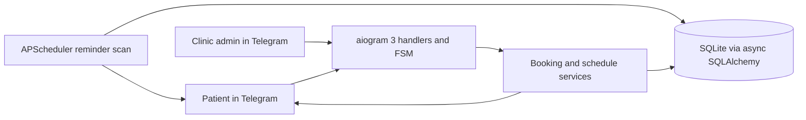

# MedSlot

MedSlot is a Telegram bot for booking appointments with a medical clinic. Patients can find a
doctor by specialty, choose an available time, manage their bookings, and receive reminders.
Clinic admins maintain doctors and their weekly schedules, review a doctor's daily bookings,
and close a day when a doctor is away.

## Architecture



The handlers validate Telegram input and delegate business rules to services. The weekly
schedule is stored, while concrete appointment slots are generated for a requested date.
Appointments store UTC start times; calendar dates and messages use the configured clinic
timezone. SQLite has a partial unique index on `(doctor_id, starts_at)` for active bookings,
so a database constraint resolves simultaneous attempts for the same slot.

## Run with Docker Compose

1. Install Docker Desktop or Docker Engine with the Compose plugin.
2. Copy `.env.example` to `.env`.
3. Set `BOT_TOKEN`, `ADMIN_IDS`, and, if needed, `TIMEZONE` in `.env`.
4. Start the bot with `docker compose up -d --build`.
5. Inspect logs with `docker compose logs -f medslot`.

The database is stored in the `medslot-data` named volume. Only one bot process should use
this SQLite database and Telegram token at a time.

## Run locally

Python 3.12 and `uv` are required. After creating `.env` from `.env.example`:

```bash
uv sync --extra dev
uv run python -m medslot
```

## Patient commands

| Command | Result |
|---|---|
| `/start` | Opens the patient entry points and clears an unfinished flow. |
| `/book` | Select specialty, doctor, date, and generated free time slot. |
| `/mine` | Lists active bookings with cancellation buttons. |
| `/cancel` | Exits the current booking or admin setup step. |

Example: `/book` → `General practice` → `Dr Example` → `2026-10-12` → `09:30`.
The actual choices depend on the doctors and schedules entered by the clinic admin.

## Admin commands

Only numeric IDs listed in `ADMIN_IDS` can use these commands. Permission is checked in each
handler and at the time of the action.

| Command | Result |
|---|---|
| `/admin` | Shows the admin command list. |
| `/add_doctor` | Starts a guided doctor and schedule form. |
| `/doctors` | Lists doctors and their IDs. |
| `/day YYYY-MM-DD ID` | Lists a doctor's active bookings for a clinic-local date. |
| `/close_day YYYY-MM-DD ID reason` | Closes that doctor's date and notifies booked patients. |

For `/add_doctor`, enter the doctor as `Name | Specialty`, then one weekly schedule line per
working interval: `1,3,5 09:00 17:00 30`. Weekdays use `1=Monday` through `7=Sunday`; the last
number is the appointment duration in minutes. Enter `готово` to save. Overlapping intervals
on one weekday are rejected.

Example admin requests:

```text
/day 2026-10-12 4
/close_day 2026-10-12 4 Sick leave
```

Closing a day marks active appointments as closed and sends each affected patient a message.
The original appointment remains in the database history.

## Technical decisions

- **aiogram 3 and FSM:** the patient selects specialty, doctor, date, and slot through inline
  controls. `/start` and `/cancel` clear an unfinished flow.
- **SQLAlchemy async and SQLite:** a single-process clinic bot can run without a separate
  database service. SQLite runs with foreign keys, WAL, and a busy timeout.
- **Generated slots:** recurring schedules define availability; no slot rows are pre-created.
  A slot is offered only when its full duration fits before closing and its start time is in
  the future.
- **Race protection:** the service checks availability again, then the database's partial
  unique index prevents a second active booking. An integrity conflict becomes a user-facing
  “slot no longer available” response.
- **Cancellation:** cancellation is allowed at exactly two hours before an appointment and
  rejected inside that window.
- **Reminders:** APScheduler scans persisted appointments once per minute. The 24-hour reminder
  is skipped if the appointment was created after its 24-hour point; the same applies to the
  2-hour reminder. Successful sends are recorded to avoid repeat delivery.
- **Data minimization:** the bot stores Telegram numeric IDs and booking details only. It does
  not request a patient's diagnosis, phone number, or medical documents.
- **Timezone:** `TIMEZONE` defaults to `Europe/Tallinn` and should be set to the clinic's IANA
  timezone. Appointment timestamps are stored in UTC.
- **Schema setup:** tables are created at startup for this first version; a migration framework
  is not included.

## Configuration

| Variable | Required | Description |
|---|---:|---|
| `BOT_TOKEN` | Yes | Token from BotFather. Keep it only in `.env`. |
| `ADMIN_IDS` | Yes | Comma-separated numeric Telegram user IDs. |
| `DATABASE_URL` | No | Async SQLAlchemy URL; defaults to the local SQLite file. |
| `TIMEZONE` | No | Clinic IANA timezone; defaults to `Europe/Tallinn`. |

## Checks

```bash
uv run ruff check .
uv run ruff format --check .
uv run python -m pytest
```

GitHub Actions runs Ruff lint, formatting checks, and pytest on every push and pull request.
