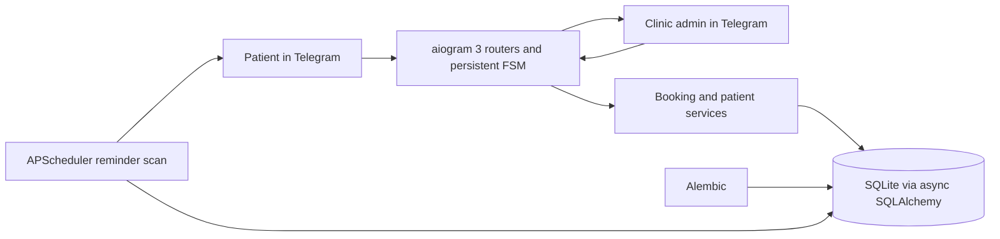

# MedSlot

MedSlot is a Telegram appointment booking bot for a medical clinic. Patients can find a doctor,
book or move an appointment, manage their contact profile, and receive reminders. Clinic admins
manage doctors and schedules, review patient details, close clinic days, and record attendance.

## Architecture



Handlers validate Telegram input and delegate business rules to service functions. Weekly work
intervals are stored; concrete free slots are generated for the requested date. Appointment
timestamps are stored in UTC and displayed in the clinic timezone. A partial unique index on
`(doctor_id, starts_at)` for active bookings protects against concurrent duplicate reservations.

## Run with Docker Compose

1. Install Docker Engine or Docker Desktop with the Compose plugin.
2. Copy `.env.example` to `.env` and set `BOT_TOKEN` and `ADMIN_IDS`.
3. Start the bot with `docker compose up -d --build`.
4. Follow logs with `docker compose logs -f medslot`.

The SQLite file is stored in the `medslot-data` named volume. Run one bot process against a
SQLite database and Telegram token at a time.

## Run locally

Python 3.12 and `uv` are required. Copy `.env.example` to `.env`, then run:

```bash
uv sync --extra dev
uv run python -m medslot
```

Pending Alembic migrations are applied before polling starts. Existing databases from the
previous create-all version are adopted in place; existing appointments are retained.

## Patient commands and flow

| Command | Result |
|---|---|
| `/start` | Shows patient entry points. |
| `/book` | Select specialty, doctor, calendar date, and generated free slot. |
| `/mine` | Lists active appointments with move and cancel actions. |
| `/profile` | Shows or edits the patient's name and phone. |
| `/privacy` | Explains the use of patient contact details. |
| `/cancel` | Exits the current dialog. |

Before a first booking, the patient enters a full name and shares a Telegram contact or types a
phone number. The bot then asks for explicit consent before saving those details. The patient can
optionally add a visit reason of up to 200 characters. A reminder sent 24 hours and 2 hours before
the appointment offers **Приду**, **Перенести**, and **Отменить**. Move and cancellation actions
are available only at least two hours before the original appointment.

Example: `/book` → choose a specialty → choose a doctor → choose a calendar date → select a time
→ enter an optional visit reason. Exact options depend on the clinic's schedule.

## Admin menu

Only Telegram IDs listed in `ADMIN_IDS` can access `/admin`. The menu uses buttons to select a
doctor and date; admins do not need to type doctor IDs.

- **Врачи** opens doctor cards. Admins can change the name, specialty, weekly schedule, or
  activation status.
- **Добавить врача** asks for `Name | Specialty`, then schedule rows such as
  `1,3,5 09:00 17:00 30`. Weekdays are `1=Monday` through `7=Sunday`; the final value is the
  appointment duration in minutes. Enter `готово` to save.
- **Расписание дня** opens a doctor picker and calendar. Each row shows patient name, phone,
  visit reason, confirmation, and no-show count. Attendance can be marked after the appointment
  start time.
- **Закрыть день** cancels that date's active appointments and sends affected patients a notice.
  **Открыть день** restores generated slots; appointments already cancelled by closure remain
  cancelled and are not silently restored.

## Screenshots

- [Patient booking](docs/screenshots/patient-booking.png)
- [Patient profile](docs/screenshots/patient-profile.png)
- [Admin menu](docs/screenshots/admin-menu.png)
- [Admin day schedule](docs/screenshots/admin-day-schedule.png)

Screenshots can be added to those paths.

## Technical decisions

- **SQLite and async SQLAlchemy:** suitable for a single bot process and straightforward backup.
- **Alembic:** schema changes are applied as versioned migrations; the adoption migration skips
  legacy tables and the next migration adds patient data and appointment fields in place.
- **Persistent FSM:** dialog state and JSON data live in SQLite, so active flows survive restart.
- **Slot generation:** slots are derived from weekly intervals for a requested date and are not
  pre-created in the database.
- **Booking race protection:** a partial unique database index is the final authority when two
  requests try to reserve one slot simultaneously; the service converts the conflict to a clear
  user message.
- **Rescheduling:** an appointment row is moved in one transaction. The old slot remains occupied
  if reserving the new slot fails.
- **Consent and visibility:** the bot stores a patient's name and phone only after consent. Clinic
  admins see these fields in the schedule; do not use the bot to submit diagnoses or documents.
- **Timezone:** `TIMEZONE` defaults to `Europe/Tallinn`; set it to the clinic's IANA timezone.
- **Logging and errors:** middleware logs update failures and returns a neutral Russian message.

## Configuration

| Variable | Required | Description |
|---|---:|---|
| `BOT_TOKEN` | Yes | Token from BotFather. Keep it only in `.env`. |
| `ADMIN_IDS` | Yes | Comma-separated numeric Telegram user IDs. |
| `DATABASE_URL` | No | Async SQLAlchemy URL; defaults to the local SQLite file. |
| `TIMEZONE` | No | Clinic IANA timezone; defaults to `Europe/Tallinn`. |

## Checks

```bash
uv run ruff check .
uv run ruff format --check .
uv run python -m pytest
```

GitHub Actions runs lint, formatting, and tests for every push and pull request.
